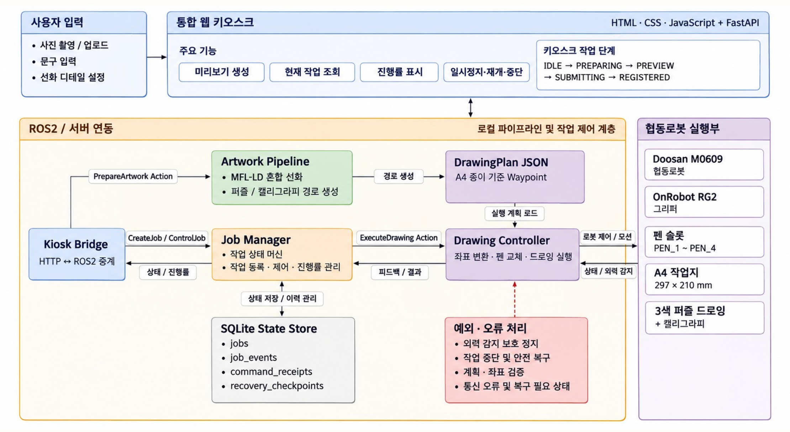
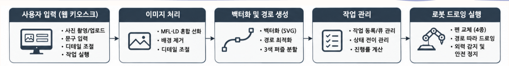

# A4 퍼즐 드로잉 로봇 (A4 Drawing Studio)
> **조 이름:** A그룹 - 4조 : A4
> **팀원:** 김용수_류민선_배준영_장태원

## 1. 🎨 시스템 설계 및 플로우 차트
프로젝트의 전체적인 구조와 소프트웨어 흐름도입니다.

### 1-1. 시스템 설계도 (System Architecture)
<p align="center">
  
</p>
* *설명: 웹 키오스크 UI에서 입력받은 사진과 문구를 ROS2 브리지(Kiosk Bridge)를 통해 Artwork Pipeline과 Job Manager(SQLite State Store)로 전달하고, Drawing Controller가 두산 M0609 로봇과 OnRobot RG2 그리퍼를 제어해 A4 드로잉을 수행하는 전체 통신 구조를 나타냅니다.*

### 1-2. 플로우 차트 (Flow Chart)
<p align="center">
  
</p>
* *설명: 사용자 입력(웹 키오스크)부터 이미지 처리(MFL-LD 혼합 선화·배경 제거), 벡터화 및 경로 생성(SVG·3색 퍼즐 분할), 작업 관리(등록·상태 전이·진행률 계산), 로봇 드로잉 실행(펜 교체·외력 감지·안전 정지)까지의 전체 프로세스 진행도를 나타냅니다.*

---

## 2. 🖥️ 운영체제 환경 (OS Environment)
이 프로젝트는 다음 환경에서 개발하였습니다.

* **OS:** Ubuntu 24.04.5 LTS
* **ROS Version:** ROS2 Jazzy
* **Language:** Python 3.12.3
* **IDE:** VS Code

---

## 3. 🛠️ 사용 장비 목록 (Hardware List)
프로젝트에 사용된 주요 하드웨어 장비입니다.

* **Doosan Robotics M0609 (6축 협동로봇)**
  * **수량:** 1
  * **비고:** A4 드로잉 및 펜 교체 수행 (`host:=192.168.1.100`, `port:=12345`, `model:=m0609`)
* **OnRobot RG2 (전동 그리퍼)**
  * **수량:** 1
  * **비고:** 드로잉 펜 파지 및 슬롯 교체 (`m0609_rg2_bringup`)
* **드로잉 펜 및 거치대 슬롯 (`PEN_1` ~ `PEN_4`, 스틱 슬롯)**
  * **수량:** 펜 4슬롯, 스틱 1슬롯
  * **비고:** 그림용 3색 펜(`PEN_1`~`PEN_3`), 캘리그래피 펜(`PEN_4`) 거치 (`config/pen_slots.json`, `config/stick_slot.json`)
* **A4 용지 및 작업대**
  * **수량:** 1
  * **비고:** 가로 `297.0 × 210.0 mm` 규격 (`ros2_ws/src/art_bringup/config/paper.yaml`, `config/plane_calibration.json`)
* **제어 PC 및 웹캠**
  * **수량:** 1
  * **비고:** ROS2 노드, 웹 키오스크 서버, AI 선화 추론 및 사진 촬영

---

## 4. 📦 의존성 (Dependencies)
프로젝트 실행에 필요한 라이브러리입니다.

* **초기 환경 일괄 설치 스크립트:** `./scripts/setup_env.bash`
* **ROS 2 / 시스템:** Ubuntu 24.04 + ROS2 Jazzy, `rclpy`, `std_msgs`, `doosan-robot2`, `onrobot-ros2`, `rg2`, `python3-opencv`, `python3-pil`, `python3-numpy`, `python3-scipy`, `python3-fonttools`
* **웹 / 브리지 (pip):**
  * `fastapi >= 0.110, < 1.0`
  * `uvicorn[standard] >= 0.29`
  * `httpx >= 0.27`
  * `python-multipart >= 0.0.9`
  * `pydantic >= 2.0`
* **AI 선화 추론 (`ros2_ws/src/art_artwork_pipeline/requirements-dl.txt`):**
  * `torch == 2.6.0`
  * `torchvision == 0.21.0`
  * `controlnet-aux == 0.0.10`
  * `transformers == 4.57.6`
  * `mediapipe == 0.10.21`
  * `opencv-contrib-python == 4.11.0.86`
  * `opencv-python-headless == 4.11.0.86`
  * `pillow == 13.0.0`
  * `numpy == 1.26.4`

---

## 5. ▶️ 실행 순서 (Usage Guide)
프로젝트를 실행하기 위한 순서입니다. 터미널 명령어를 순서대로 입력해 주세요.

### Step 1. 로봇 초기화 및 드라이버 연결
로봇의 전원을 켜고 이더넷(`192.168.1.100`) 통신을 연결합니다.
```bash
source /opt/ros/jazzy/setup.bash
source ~/A4/ros2_ws/install/setup.bash
ros2 launch m0609_rg2_bringup bringup.launch.py mode:=real host:=192.168.1.100 port:=12345 model:=m0609
```

### Step 2. 메인 시스템 노드 실행
A4 드로잉 파이프라인, 작업 관리자, 컨트롤러, 브리지, 키오스크 노드를 일괄 실행합니다.
```bash
cd ~/A4/ros2_ws
source /opt/ros/jazzy/setup.bash
source install/setup.bash
export ART_JOB_PLAN_ROOT="$HOME/A4/data/jobs"
export ART_STATE_DB_PATH="$HOME/A4/data/art_state.db"
export ART_LINEART_METHOD=mfl_ld
ros2 launch art_bringup art_system.launch.py
```
> 참고: 로봇 연결부터 키오스크 앱 창 실행까지 한 번에 실행하려면 `~/A4/scripts/launch_a4_app.bash`를 실행할 수 있습니다.

### Step 3. 키오스크 및 관리자 화면 접속
브라우저에서 아래 주소로 접속해 사진·문구를 입력하고 드로잉을 시작합니다.
* **사용자 키오스크:** `http://127.0.0.1:8000`
* **관리자 제어 화면:** `http://127.0.0.1:8000/admin`
