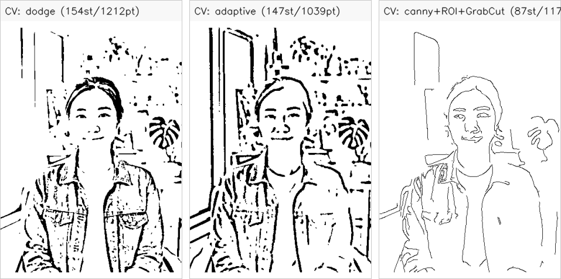
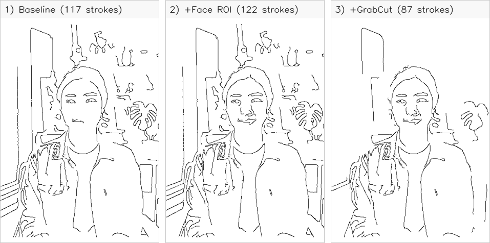
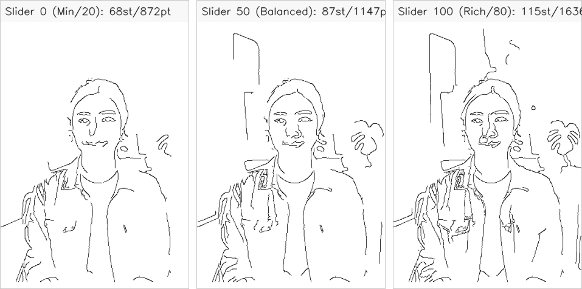
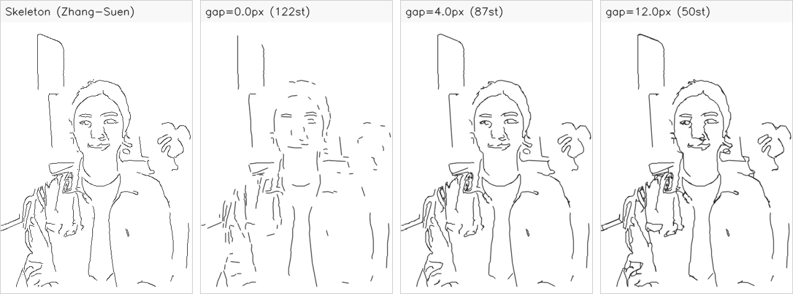
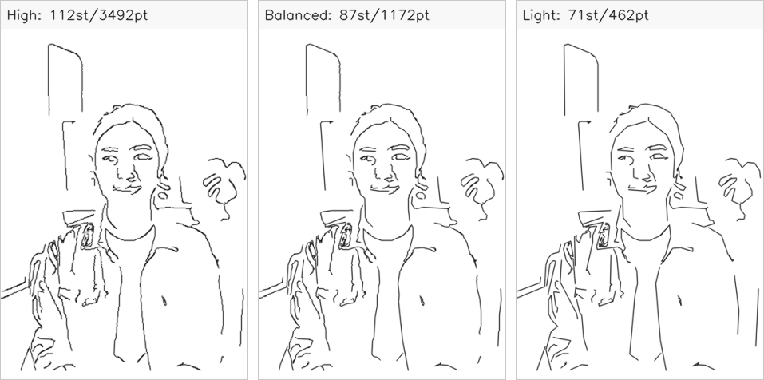
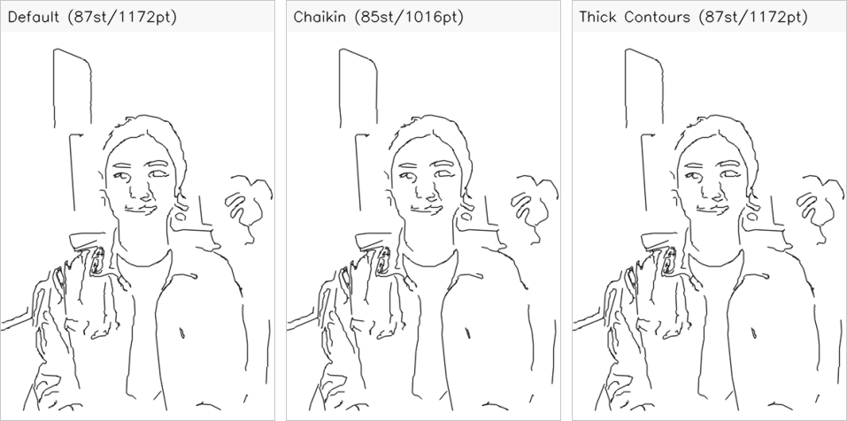
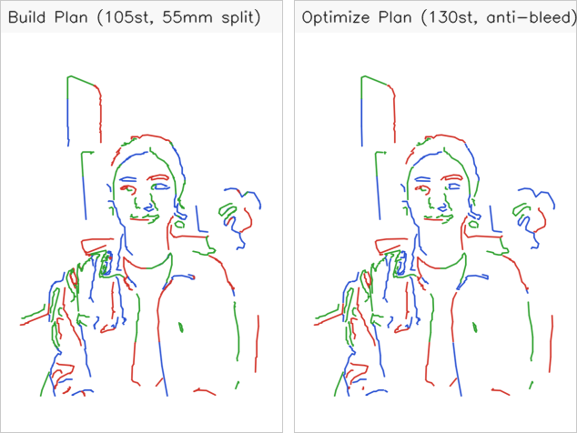
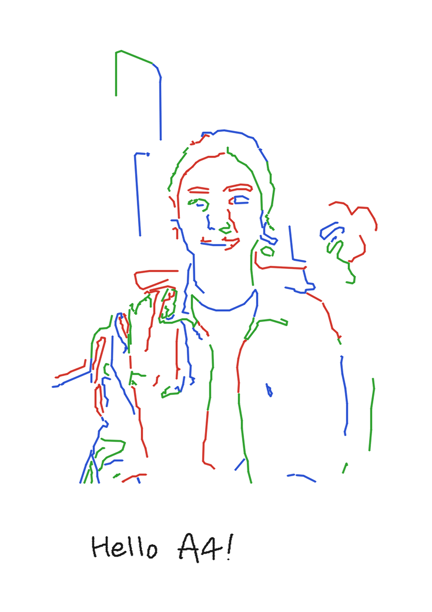
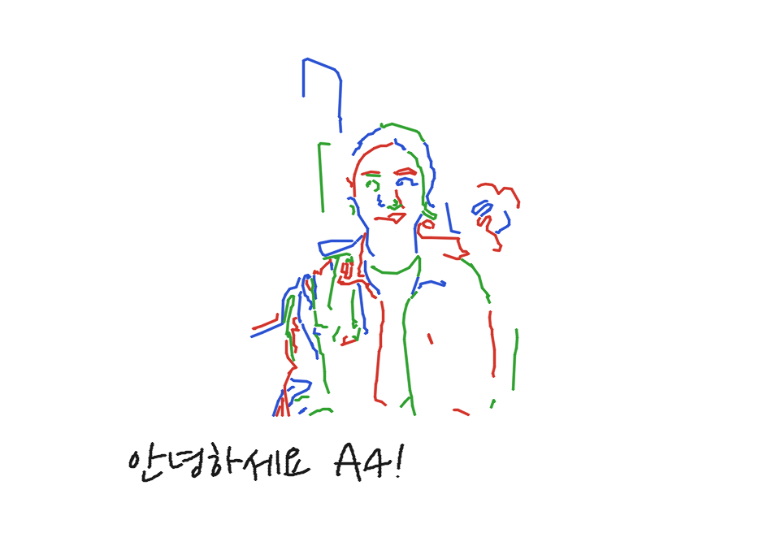

# A4 드로잉 파이프라인: 이미지 수신부터 벡터 변환까지 (발표용 정리)

이 문서는 **2026년 11월 16일 ~ 11월 20일** 동안 진행한 A4 드로잉 로봇 파이프라인의 전체 흐름(이미지 수신 → 선화 추출 → 벡터 변환 → 3색 펜 배정·최적화 → 최종 실행 계획 생성)과, 개발 과정에서 겪은 **시행착오 및 개선 내역**을 발표자료로 활용할 수 있도록 정리한 문서입니다.

모든 단계별 샘플과 수치는 생성형 인물 이미지 1장([00_gen_input.png](./samples_gen/00_gen_input.png))을 현재 저장소(`ros2_ws/src/art_artwork_pipeline`)의 실제 코드에 통과시켜 생성했습니다.

---

## 0. 전체 파이프라인 한눈에 보기

- **1단계 — 이미지 수신 및 정규화**: 키오스크 웹캠·파일 업로드 수신(`art_kiosk`), 회전·해상도 정규화(`save_photo`)
- **2단계 — 선화(Lineart) 추출**: 인물/얼굴 ROI 분리 및 밀도 슬라이더 보간(`lineart_cv.py`, `lineart_mfl_ld.py`, `pipeline_runner.py`)
- **3단계 — 벡터 경로 추출**: 이진화 → Zhang-Suen 세선화 → 공간 그리드 기반 끊김 병합 → 길이 필터·단순화(`extractor.py`)
- **4단계 — 3색 펜 배정 및 최적화**: 55mm 장획 분할·균형 배정(`drawing_plan.py`), 잉크 번짐 방지·점 간격 정리(`path_optimizer.py`)
- **5단계 — 캘리그래피 합성 및 최종 출력**: `PEN_4` 캘리그래피 결합, `DrawingPlan v0.2`(`drawing_plan.json`) 및 `preview.svg` 생성

### 기준 입력 이미지 (생성형 샘플)

- **원본 파일**: [00_gen_input.png](./samples_gen/00_gen_input.png) (`896×1200` RGB 인물 사진)
- **선택 이유**: 정면 얼굴(이목구비), 머리카락·데님 재킷 디테일, 그리고 창문·이젤·화분 등 실내 배경이 함께 있어 **얼굴 ROI 보정**과 **배경 억제(GrabCut)** 효과를 한눈에 비교하기에 적합합니다.

---

## 1단계. 이미지 수신 및 입력 정규화

### 구현 구조

- **프론트엔드 수신 경로 (`ros2_ws/src/art_kiosk/art_kiosk/static/app.js`)**
  - **웹캠 촬영**: `getUserMedia`로 영상을 받아 좌우 반전(`mirrored`), 3초 타이머(`btnCaptureTimer`), 즉시 촬영(`btnCaptureNow`)을 지원하며, `771×510` 비율로 중앙 크롭해 PNG Blob으로 변환합니다.
  - **파일 첨부**: `photoFileInput`을 통해 로컬 이미지 파일을 직접 선택할 수 있습니다.
- **서버 검증 및 정규화 (`server.py`, `workflow.py`, `preprocess.py`, `pipeline_runner.py`)**
  - **입력 검사 모듈 (`art_kiosk/preprocess.py`)**: AI 키워드 생성 흐름을 위해 금칙어 필터(`FORBIDDEN_WORDS`) 및 한글→영문 기본 매핑(`KO_TO_EN_DICT`)을 제공하는 `validate_and_clean_keywords()`와, 투명 배경을 흰색으로 합성한 뒤 최소 어두운 픽셀 비율(`min_dark_ratio=0.0005`)을 검사해 빈 이미지를 걸러내는 `validate_non_empty_sketch()`가 구현되어 있습니다.
  - **이중 API 구조**: 초기 단일/확인형 엔드포인트(`/api/kiosk/photo-to-lineart`, `/api/kiosk/confirm-lineart`, `server.py`)와 현재 메인 워크플로우(`/api/kiosk/prepare`, `/api/kiosk/draw`, `workflow.py`)가 공존합니다.
  - `POST /api/kiosk/prepare`가 최대 `20 MB` 이하 사진과 `detail`(0~100), `paper`, `text`를 수신합니다.
  - `save_photo`는 최대 해상도 `25,000,000 px` 이하를 검사한 뒤, `ImageOps.exif_transpose()`로 스마트폰 EXIF 회전 정보를 바로잡고 `RGB` 변환 및 `1024×1024` 이하 축소(`thumbnail`)를 거쳐 작업 폴더에 `photo.png`로 저장합니다.
  - 생성형 샘플 적용 결과: `896×1200` → `765×1024` `photo.png`로 정규화되었습니다.
- **용지 규격 및 가로 여백 배치 (`paper.py`)**
  - `a4` (세로 `210×297 mm`, 여백 `15 mm`) 외에 키오스크 기본값인 `a4_landscape_margin` (가로 `297×210 mm`, 사방 `20 mm` 여백)을 지원합니다.
  - 가로 모드에서는 `fit_landscape_preview()`가 `3 px/mm` 기준 `891×630 px` 캔버스의 중앙 `771×510 px` 영역에 이미지를 배치하고, 이후 `pipeline_runner.py`가 `x-60`, `y-60`으로 여백을 제외한 내부 좌표로 재매핑해 이중 여백을 방지합니다.

### 시행착오 및 변경 과정

- **시행착오 1 — 슬라이더 조작 시 자동 재추출과 409 충돌**
  - **문제**: 초기에는 디테일 슬라이더를 움직일 때마다 즉시 `prepare` 요청이 발생해 이전 작업과 잠금(`workflow_lock`)이 부딪히며 `409` 충돌과 대기 지연이 잦았습니다.
  - **해결**: 이전 추출이 진행 중일 때 `POST /bridge/artwork/cancel`을 먼저 호출하도록 보완한 뒤, 최종적으로 슬라이더 변경 시에는 상태만 무효화(`invalidate()`)하고 사용자가 **`경로 추출` 버튼(`btnExtract`)을 명시적으로 눌렀을 때만** 실행하도록 전환했습니다.
- **시행착오 2 — 문구만 바꿔도 선화를 매번 다시 추출하던 비효율**
  - **문제**: 하단 캘리그래피 문구(`text`)만 수정해도 무거운 선화 추출(`LINEART` 단계)을 처음부터 다시 실행했습니다.
  - **해결**: `photo_sha256`, `_lineart_bucket(detail)`, `paper`, `method`가 모두 같고 기존 `lineart.png`가 유효하면 `os.link`로 선화를 재사용(`can_reuse`)하고 `PLAN` 단계만 다시 계산하도록 개선했습니다.
- **보안·상태 경계 분리**
  - 단순 미리보기(`PREVIEW`)와 로봇 물리 실행 승인(`confirmed` / `approved`)을 분리하고, `ticket` 및 `input_sha256` 지문 검증을 통해 잘못된 중복 실행을 차단했습니다.

---

## 2단계. 선화(Lineart) 추출 및 디테일 제어

### 선화 엔진 변천사 및 시행착오

- **1차 시도 — 클라우드 AI API (`phase2_ai_lineart`)**
  - 외부 API 기반 선화 변환을 실험했으나, 네트워크 지연·외부 서비스 의존성·비용 문제로 키오스크 현장 운용에 부적합하다고 판단해 로컬 추론으로 전환했습니다.
- **2차 시도 — 로컬 딥러닝 단독 (`lineart_dl.py`, `LineartConverterDL`)**
  - `smooth_photo_preserve_edges()`(`cv2.edgePreservingFilter`)로 질감을 정리한 뒤 `controlnet_aux.LineartDetector`(`lllyasviel/Annotators`, `512×512`)로 추론하고, 반전 후 `binarize_gray()`(임계값 이진화 + `connectedComponentsWithStats` 기반 `min_component_area` 작은 잡음 제거)를 수행합니다.
  - 깔끔한 외곽선을 얻었으나, 얼굴 이목구비가 뭉개지거나 배경·피부 잔선이 과도하게 잡히는 경우가 있었고 무거운 PyTorch 환경 분리(`~/.venvs/a4-lineart`)가 필요했습니다.
- **3차 시도 — 하이브리드 엔진 (`lineart_mfl_ld.py`, `LineartConverterMflLd`)**
  - 전체 이미지에 `LineartConverterDL`을 실행한 뒤, MediaPipe `FaceLandmarker`(`face_landmarker.task`)로 `FACE_LANDMARKS_FACE_OVAL` 다각형을 검출하고 머리카락 확장 타원(`hair_top_extend_ratio=0.45`, `hair_side_extend_ratio=0.15`, `mask_dilate_px=6`)을 합쳐 얼굴 ROI 마스크를 만듭니다.
  - `compose_face_lineart()`가 마스크 내부는 `bilateralFilter` + `Canny(22, 65)` + `dilate(2×2)`로 이목구비를 선명하게 추출하고, 마스크 외부는 `LineartDetector` 결과를 유지해 합성합니다. 현재 키오스크(`workflow.py`)의 기본 엔진(`method = 'mfl_ld'`)으로 고정되어 있습니다.
- **4차 시도 — 경량 OpenCV 트랙 및 3가지 스케치 모드 (`lineart_cv.py`, `LineartConverterCV`)**
  - DL 가상환경이 없는 환경이나 빠른 CPU 테스트(`method='cv'`)를 위해 OpenCV 기반 3가지 모드(`dodge`, `adaptive`, `canny`)가 구현되어 있으며, `canny` 모드를 단계적으로 고도화했습니다.
  - **`dodge` 모드 (`_dodge_sketch`)**: 흑백 반전 + 가우시안 블러 + `cv2.divide(..., scale=256.0)` 연필 스케치 효과 후 이진화합니다.
  - **`adaptive` 모드 (`_adaptive_sketch`)**: `bilateralFilter` 후 `cv2.adaptiveThreshold(ADAPTIVE_THRESH_GAUSSIAN_C)`로 고대비 흑백 선을 추출합니다.
  - **`canny` Baseline**: 전체 이미지에 단순 `bilateralFilter` + `Canny` 적용 시 눈·코·입 디테일이 빠지고 창문·이젤 같은 배경 선이 그대로 남았습니다.
  - **`canny` + Face ROI 추가**: OpenCV Haar Cascade(`haarcascade_frontalface_default.xml`)로 얼굴 타원 마스크를 만들고, 내부에만 2단계 `bilateralFilter` + 낮은 Canny 임계값을 적용해 이목구비를 살렸습니다.
  - **`canny` + GrabCut 인물 전경 분리 추가**: 얼굴 위치 기준으로 `cv2.grabCut` 전경 마스크(`_build_person_mask`)를 생성하고, 배경 영역에는 `GaussianBlur(7, 7)` + 상향된 Canny 임계값 + `connectedComponentsWithStats`(`area >= 28` 또는 `max(bw, bh) >= 26`)를 적용해 자잘한 배경 잡음을 제거했습니다.

### 샘플 비교 0 — OpenCV 3가지 모드(`dodge` vs `adaptive` vs `canny`) 비교

`LineartConverterCV`에 구현된 3가지 모드를 동일 이미지에 적용한 결과입니다.

- **`dodge` 모드**: `154`획 / `1,212`점 / 그리기 길이 `6,065.0`px — 명암 대비가 강한 면·음영 위주로 추출되어 배경과 옷 질감이 두껍게 남습니다.
- **`adaptive` 모드**: `147`획 / `1,039`점 / 그리기 길이 `6,379.0`px — 외곽선 대비가 뚜렷하지만 명암 경계마다 굵은 띠가 형성됩니다.
- **`canny` + Face ROI + GrabCut (현재 CV 기본)**: `87`획 / `1,172`점 / 그리기 길이 `6,128.7`px — 1px 중심선 위주의 깔끔한 윤곽선과 인물 집중도가 가장 높습니다.

### 샘플 비교 1 — Baseline vs Face ROI vs GrabCut

동일 조건(`detail='50'`, `max_side=512`, `paper='a4'`)에서 세 구성을 실행해 벡터화한 결과입니다.

- **1) Baseline Canny** (`use_face_roi=False`, `use_person_segmentation=False`)
  - 추출 결과: `117`획 / `1,841`점
  - 특징: 코 윤곽이 거의 소실되고, 배경의 창틀·이젤·선반·식물 선이 다수 포함됩니다.
- **2) + Face ROI** (`use_face_roi=True`, `use_person_segmentation=False`)
  - 추출 결과: `122`획 / `1,879`점
  - 특징: 얼굴 내부 눈·코·입 윤곽선이 또렷하게 복원됩니다.
- **3) + Face ROI & GrabCut (CV 최종 적용)** (`use_face_roi=True`, `use_person_segmentation=True`)
  - 추출 결과: `87`획 / `1,172`점
  - 특징: 얼굴 디테일은 그대로 유지하면서 배경 잡음 획을 **약 `28.7%`(`122` → `87`획) 감축**했습니다.

### 시행착오 — 디테일 프리셋 3단계에서 연속 슬라이더 보간으로 전환

- **문제**: 초기 `low` / `medium` / `high` 3단계 고정 프리셋은 단계 간 선화 밀도 차이가 너무 커서 중간 톤을 맞추기 어려웠습니다.
- **해결 (`resolve_cv_density_params`)**: 외부 슬라이더 입력(`0~100`)을 실제 유효 구간(`20~80`)에 매핑한 뒤, 5개 기준점(`DENSITY_ANCHORS`: `Minimal`~`Very Rich`) 사이에서 Canny 임계값, 얼굴 Canny 임계값, `face_bilateral_sigma`, `min_length_px`를 선형 보간하도록 변경했습니다.

### 샘플 비교 2 — 디테일 슬라이더 값(`0` / `50` / `100`)에 따른 변화

- **슬라이더 `0` (실제 보간 위치 `20`)**
  - 파라미터: `canny=(71, 182)`, `face_canny=(54, 134)`, `min_length_px=12.0`
  - 추출 결과: `68`획 / `872`점 (굵직한 윤곽 중심)
- **슬라이더 `50` (실제 보간 위치 `50`, 표준)**
  - 파라미터: `canny=(55, 145)`, `face_canny=(45, 115)`, `min_length_px=7.0`
  - 추출 결과: `87`획 / `1,147`점 (인물 묘사와 획 수의 균형)
- **슬라이더 `100` (실제 보간 위치 `80`)**
  - 파라미터: `canny=(40, 114)`, `face_canny=(34, 91)`, `min_length_px=5.2`
  - 추출 결과: `115`획 / `1,636`점 (옷 주름·머리카락 세밀 묘사 증가)

---

## 3단계. 벡터 경로 추출 및 스켈레톤 최적화 (`extractor.py`)

선화 PNG(래스터 이미지)를 로봇이 따라 그릴 수 있는 폴리라인 좌표 리스트로 바꾸는 단계입니다.

### 처리 흐름

- **1. 이진화 (`_binarize_lineart`)**: 흰 배경 위 검은 선을 반전 이진 마스크로 변환합니다.
- **2. 세선화 (`cv2.ximgproc.thinning`)**: Zhang-Suen 알고리즘으로 선 두께를 1px 중심선(Skeleton)으로 줄입니다. 생성형 샘플 기준 원시 스켈레톤 분절 수는 **`3,368`개**입니다.
- **3. 그래프 추적 (`_trace_skeleton_strokes`)**: 8방향 이웃 연결 수를 계산해 끝점·분기점(`deg != 2`)과 폐곡선 루프를 따라 폴리라인을 추출합니다.
- **4. 끊어진 선 병합 (`_bridge_close_strokes`)**: 끝점 간 거리가 `bridge_gap_px` 이하인 열린 획을 하나의 연속 획으로 이어 펜 업/다운 횟수를 줄입니다.
- **5. 길이 필터링 및 단순화 (`_simplify_and_filter`)**: `min_length_px` 미만 짧은 잡음을 버리고 `cv2.approxPolyDP`로 꼭짓점 수를 줄입니다.
- **6. 이동 거리 최소화 정렬 (`_order_strokes_tsp`)**: 탐욕 최근접 이웃 + 방향 반전으로 펜을 든 채 이동하는 공중 이동 거리(`travel_length_px`)를 줄입니다.

### 시행착오 및 변경 과정

- **시행착오 1 — `3,368`개 조각을 그대로 그려 발생하던 잦은 펜 업/다운**
  - **문제**: 세선화 직후에는 1~3px 간격으로 끊긴 선분이 수천 개 생겨 로봇이 선을 조금 그리고 펜을 들었다 내리기를 반복했습니다.
  - **해결**: `bridge_gap_px=4.0`을 기본 적용해 인접 끝점을 이어주었고, 최근 커밋(`c46dfb7`)에서는 전체 쌍 비교($O(N^2)$) 병목을 **공간 그리드(`inv_cell = 1.0 / max_gap_px`)** 기반 3×3 셀 탐색으로 바꿔 대규모 선화에서도 빠르게 병합되도록 최적화했습니다.
- **시행착오 2 — 과도한 스무딩(`Chaikin`)으로 인한 각진 디테일 뭉개짐**
  - **문제**: 초기에는 픽셀 계단 현상을 없애려고 `smooth_iterations=2`와 두꺼운 영역 외곽선 추출(`preserve_thick_contours=True`)을 켰으나, 작은 눈·코 선이 뭉개지거나 이중선이 생겼습니다.
  - **해결**: `pipeline_runner.py`에서 `smooth_iterations=0`, `preserve_thick_contours=False`로 고정해 선화 원형을 보존했습니다.

### 샘플 비교 3 — 스켈레톤 및 병합 거리(`bridge_gap_px`) 비교

- **원시 스켈레톤 (Zhang-Suen)**: `3,368`개 원시 분절
- **병합 없음 (`bridge_gap_px=0.0`)**: `122`획 / `424`점 / 공중 이동 `2,672.8`px (짧은 단절 다수)
- **표준 병합 (`bridge_gap_px=4.0`, 현재 적용)**: `87`획 / `1,172`점 / 공중 이동 `2,578.2`px (자연스러운 연결로 획 수 약 `29%` 감소)
- **과도한 병합 (`bridge_gap_px=12.0`)**: `50`획 / `1,351`점 / 공중 이동 `1,958.6`px (획 수는 줄지만 서로 다른 윤곽선이 이어질 위험 증가)

### 샘플 비교 4 — 최소 길이(`min_length_px`) 및 단순화(`epsilon`) 비교

- **High Detail (`min_length_px=5.2`, `epsilon=0.5`)**: `112`획 / `3,492`점 / 그리기 길이 `8,000.7`px — 세밀하지만 제어점 수가 너무 많아 로봇 통신·모션 부하가 큽니다.
- **Balanced (`min_length_px=7.0`, `epsilon=0.9`, 현재 적용)**: `87`획 / `1,172`점 / 그리기 길이 `6,128.7`px — 형태를 유지하면서 점 개수를 약 **`66%`(`3,492` → `1,172`점) 감축**했습니다.
- **Light (`min_length_px=15.0`, `epsilon=1.8`)**: `71`획 / `462`점 / 그리기 길이 `5,200.4`px — 점은 가장 적지만 얼굴·재킷의 짧은 디테일이 탈락합니다.

### 샘플 비교 4-1 — 구현된 후처리 옵션(`Chaikin`, `preserve_thick_contours`) 비교

`extractor.py`에는 기본 파이프라인 외에 선택적 후처리 옵션 2가지가 더 구현되어 있습니다.

- **Default (`smooth_iterations=0`, `preserve_thick_contours=False`)**: `87`획 / `1,172`점 / 그리기 길이 `6,128.7`px — 현재 `pipeline_runner.py` 기본 설정입니다.
- **+ Chaikin 스무딩 (`_chaikin_smooth`, `smooth_iterations=2`)**: `85`획 / `1,016`점 / 그리기 길이 `5,842.4`px — 코너 커팅(0.75/0.25 가중 평균)으로 픽셀 계단 현상을 부드럽게 완화합니다.
- **+ 두꺼운 영역 외곽선 보존 (`_extract_thick_region_contours`, `preserve_thick_contours=True`)**: `87`획 / `1,172`점 — `cv2.distanceTransform`으로 반폭 `1.8 px` 이상인 두꺼운 채움 영역이 있을 때 외곽 컨투어를 추가 추출합니다(얇은 Canny 선화에서는 기본과 동일).

---

## 4단계. 3색 펜 배정 및 잉크 번짐 방지 최적화

추출된 픽셀 좌표를 실제 A4 용지 좌표(`mm`)로 변환하고, `PEN_1`(파랑)·`PEN_2`(빨강)·`PEN_3`(초록) 3가지 펜에 나누어 배정하는 단계입니다.

### 시행착오 및 변경 과정

- **시행착오 1 — 4×4 격자 단색 배정에서 3색 균형 배정 + 장획 분할로 전환**
  - **문제**: 초기에는 A4를 `4×4` 격자로 나누어 영역별로 펜 색을 고정했는데, 특정 영역에 긴 윤곽선이 몰리면 한 가지 색만 지나치게 많이 쓰이고 시각적으로 단조로웠습니다.
  - **해결 (`drawing_plan.py`, `puzzle/colors.py`)**: `max_stroke_mm=55.0`을 넘는 긴 획을 균등 분할하고, 긴 획부터 순회하며 ① 인접 분할 쌍(`connected_pairs`)과 다른 색, ② 공간상 가장 가까운 기존 획과 다른 색, ③ 현재 누적 길이(`pen_totals`)가 가장 적은 펜 순으로 배정하도록 바꿨습니다.
- **시행착오 2 — 분할된 조각이 동색을 받아 다시 합쳐지던 버그**
  - **문제**: `55mm`로 나눈 인접 두 조각이 우연히 같은 펜을 배정받으면, 후속 `optimize_plan` 병합 단계에서 다시 하나의 긴 획으로 합쳐졌습니다.
  - **해결**: `build_plan`이 분할 시 `connected_pairs`를 기록하고 `assign_stroke_pens`가 최우선 순위에서 인접 분할 조각 간 **서로 다른 펜을 강제**하도록 수정했습니다.
- **이중 최적화 백엔드 (`path_optimizer.py`)**: `vpype` CLI(`linemerge`, `linesimplify`, `linesort`) 백엔드와, 별도 설치 없이 동작하는 순수 OpenCV 폴백(`_merge_same_pen`, `_simplify_same_pen`, `_sort_same_pen`)을 모두 지원하며 `pipeline_runner.py`는 `backend='opencv'`를 사용합니다.
- **시행착오 3 — 실기 드로잉 시 잉크 번짐 및 촘촘한 점 떨림**
  - **문제**: 점 간격이 너무 좁거나(`0.2mm` 이하) 같은 위치를 여러 번 덧칠하면 붓펜·사인펜 잉크가 종이에 번지고 로봇 감속이 심해졌습니다.
  - **해결 (`pipeline_runner.py` → `optimize_plan`)**:
    - `min_point_spacing_mm=0.85` (`_clean_dwell_points`): `0.85mm` 미만 미세 정체 점 병합
    - `simplify_tolerance_mm=0.22`: 용지 좌표 기준 `0.22mm` 추가 단순화
    - `min_stroke_mm=2.5`: `2.5mm` 미만 짧은 점선 제거
    - `max_ink_passes=1`, `max_local_ink_mm=6.5` (`_limit_ink_overdraw`): 동일 경로 덧칠 차단 및 국부 패치 잉크 밀도 제한
    - `_smooth_curve` (`curve_step_mm`): 필요 시 곡선 보간 리샘플링도 가능하도록 구현되어 있습니다(`pipeline_runner.py`에서는 `0`으로 비활성).

### 샘플 비교 5 — `build_plan` 직후 vs `optimize_plan` 적용 후

- **최적화 전 (`build_plan` 직후)**: 총 `105`획 / `1,208`점
  - `PEN_1` (파랑): `33`획 / `957.6`mm
  - `PEN_2` (빨강): `36`획 / `968.8`mm
  - `PEN_3` (초록): `36`획 / `969.0`mm
- **최적화 후 (`optimize_plan` 적용)**: 총 `130`획 / `798`점 (총 점 개수 **`34%` 감축**, 중복·과밀 구간 정리로 총 길이 `2,895.4`mm → `2,327.3`mm)
  - `PEN_1` (파랑): `41`획 / `807.2`mm
  - `PEN_2` (빨강): `38`획 / `742.0`mm
  - `PEN_3` (초록): `51`획 / `778.1`mm

---

## 5단계. 캘리그래피 합성 및 최종 실행 계약 출력 (`prepare_artwork`)

마지막으로 하단 텍스트 영역에 검정 4번 펜(`PEN_4`) 캘리그래피 획을 추가하고, 로봇 제어기(`art_drawing_controller`)가 읽는 `DrawingPlan v0.2`(`drawing_plan.json`)와 키오스크 미리보기(`preview.svg`)를 원자적으로 기록합니다.

### 캘리그래피 엔진 변천사 (`cursive_font.py` → `generator.py`)

- **초기 단선 필기체 (`cursive_font.py`)**: 영문 대소문자 52자 단선 필기체 벡터 사전을 직접 정의해 사용했으나 한글·다국어·특수문자 표현에 한계가 있었습니다.
- **유니코드·다국어 정자체 및 가변 필압 (`generator.py`)**: 프로젝트 내장 붓글씨 폰트(`assets/fonts/NanumBrush.ttf`)와 Fontconfig 시스템 폰트 폴백을 결합해 한글·영문·일본어·중국어·특수문자를 지원합니다. 글리프 렌더링 후 Zhang-Suen 세선화, 잔가지 제거(`_prune_spurs`), 사람 필순 방향 정렬(`_orient_human_stroke`), `cv2.distanceTransform` 기반 가변 필압(`pressure_scale`) 샘플링을 거쳐 `PEN_4` 획을 생성합니다.

### 생성형 샘플 최종 통합 결과 (세로 `a4`, 영문 캘리그래피)

`prepare_artwork`를 `method='cv'`, `paper='a4'`, `detail='50'`, `seed=42`, `text='Hello A4!'` 조건으로 끝까지 실행한 결과입니다.

- **총 실행 규모**: **`133`획 / `1,105`점**
- **펜별 분포**
  - `PEN_1` (파랑, 그림): `39`획 / `713.5`mm
  - `PEN_2` (빨강, 그림): `38`획 / `657.2`mm
  - `PEN_3` (초록, 그림): `40`획 / `678.2`mm
  - `PEN_4` (검정, `Hello A4!`): `16`획 / `166.2`mm
- **생성 파일**
  - 최종 선화: [06_final_lineart.png](./samples_gen/06_final_lineart.png)
  - 최종 미리보기 PNG: [07_final_preview.png](./samples_gen/07_final_preview.png)
  - 최종 미리보기 SVG: [07_final_preview.svg](./samples_gen/07_final_preview.svg)
  - 실행 통계 JSON: [stats.json](./samples_gen/stats.json)

### 키오스크 기본 규격 통합 결과 (`a4_landscape_margin`, 한글 캘리그래피)

키오스크 실사용 기본 용지인 가로 여백 규격(`paper='a4_landscape_margin'`, `297×210 mm`, `text='안녕하세요 A4!'`)으로 실행한 결과입니다.

- **총 실행 규모**: **`118`획 / `1,166`점** (`PEN_1` `29`획, `PEN_2` `29`획, `PEN_3` `30`획, `PEN_4` `30`획)
- **생성 파일**: [10_landscape_korean_preview.png](./samples_gen/10_landscape_korean_preview.png) / [10_landscape_korean_preview.svg](./samples_gen/10_landscape_korean_preview.svg)

