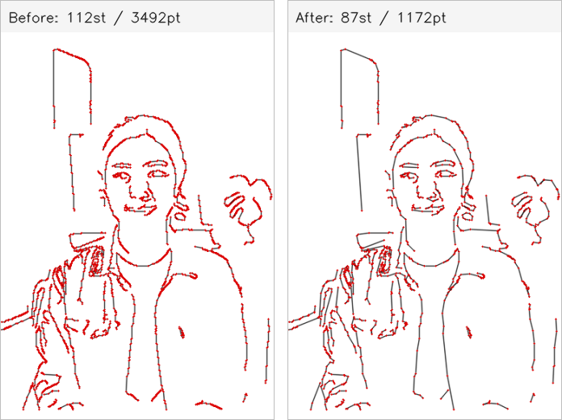
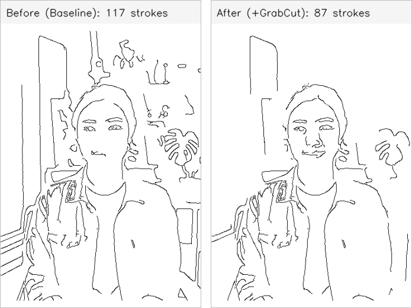
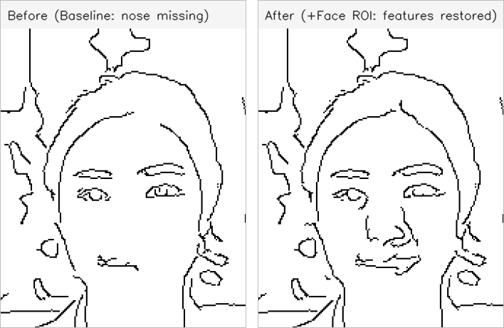
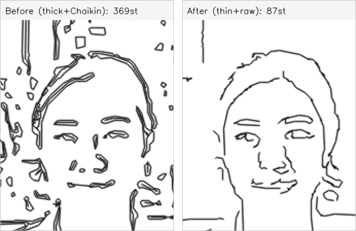

# A4 드로잉 파이프라인 시행착오 및 개선 사례 (발표 슬라이드용)

동일한 생성형 인물 이미지([00_gen_input.png](./samples_gen/00_gen_input.png))를 기준으로, 핵심 시행착오 4가지의 **문제점 · 해결 방법 · 적용 전후 비교**를 슬라이드 단위로 정리했습니다.

---

## 슬라이드 1. 점(Point)과 획(Stroke)이 너무 많이 생기는 문제

### 문제점
- Zhang-Suen 세선화 직후에는 1~3px 간격으로 끊긴 원시 선분(`3,368`개)이 그대로 남아 로봇 펜 업/다운 횟수가 폭증합니다.
- 단순화 임계값이 낮으면(`epsilon=0.5`, `min_length_px=5.2`) 제어점이 `3,492`개까지 불어나 로봇 통신·감속 부하가 커지고, `0.2 mm` 이하 미세 정체 점들이 모여 잉크 번짐과 떨림을 유발합니다.

### 해결 방법
- **끊김 병합 (`_bridge_close_strokes`)**: `bridge_gap_px=4.0`으로 인접 끝점을 이어 획 수를 줄이고, 공간 그리드(`inv_cell`) 기반 3×3 셀 탐색으로 $O(N^2)$ 병목을 제거했습니다.
- **단순화 및 길이 필터링 (`_simplify_and_filter`)**: `epsilon=0.9`, `min_length_px=7.0`(표준)을 적용해 형태를 유지하면서 점 개수를 줄였습니다.
- **후속 모션·정체점 정리 (`optimize_plan`)**: `min_point_spacing_mm=0.85`, `simplify_tolerance_mm=0.22`, `min_stroke_mm=2.5`로 미세 정체 점과 짧은 잡음을 추가 제거했습니다.

### 적용 전후 비교
- **Before** (`epsilon=0.5`, `min_length_px=5.2`): **`112`획 / `3,492`점** (빨간 꼭짓점이 선을 따라 촘촘하게 밀집)
- **After** (`epsilon=0.9`, `min_length_px=7.0`): **`87`획 / `1,172`점** (획 수 **`22.3%`**, 점 개수 **`66.4%` 감축**)
- **최종 `optimize_plan` 추가 적용 시**: `105`획/`1,208`점 → `130`획/`798`점 (점 개수 추가 `34%` 감축)

---

## 슬라이드 2. 잔선·배경 잡음이 너무 많이 잡히는 문제

### 문제점
- `dodge`·`adaptive` 모드는 벽면·옷 주름·음영까지 굵은 잔선(`147~154`획)으로 추출해 로봇 드로잉에 부적합했습니다.
- 기본 `canny` 모드에서도 창틀·이젤·화분·선반 등 배경 윤곽선이 인물과 동일한 비중으로 추출되어 불필요한 획이 많았습니다.
- 좁은 영역에 획이 겹치거나 반복 덧칠되면 종이가 젖고 잉크가 번졌습니다.

### 해결 방법
- **1px 중심선 기반 `canny` 채택**: 음영 면 대신 윤곽선 중심의 `canny` 모드를 주력으로 사용했습니다.
- **GrabCut 인물 전경 분리 (`_build_person_mask`)**: 얼굴 위치 기준으로 `cv2.grabCut` 전경 마스크를 생성하고, 배경 영역에는 `GaussianBlur(7, 7)` + 상향 Canny 임계값 + `connectedComponentsWithStats`(`area >= 28` 또는 `max(bw, bh) >= 26`)를 적용해 큰 외곽선만 남겼습니다.
- **잉크 덧칠·과밀 제한 (`_limit_ink_overdraw`)**: `max_ink_passes=1`, `max_local_ink_mm=6.5`로 동일 경로 재그리기와 국부 잉크 과밀을 차단했습니다.

### 적용 전후 비교
- **Before** (`Baseline Canny`, 배경 분리 없음): **`117`획 / `1,841`점** (창문·이젤·식물·선반 배경 잔선 다수 포함)
- **After** (`+ GrabCut` 및 배경 성분 필터링): **`87`획 / `1,172`점** (인물 윤곽은 유지하면서 배경 잡음 획 **`25.6%`** 감축, `+Face ROI` 대비 **`28.7%`** 감축)

---

## 슬라이드 3. 얼굴을 인식하지 못하거나 이목구비가 누락되는 문제

### 문제점
- 전체 사진에 동일한 Canny 임계값을 적용하면 피부 톤 변화가 약한 코·입술·눈매 윤곽이 소실됩니다.
- 반대로 임계값을 전체적으로 낮추면 배경과 옷 질감의 잡선이 폭증하고, DL 단독 모델(`LineartDetector`)은 얼굴 특징이 뭉개지거나 피부 잡선이 생깁니다.
- 측면·가려짐·가상환경 미설치 상황에서는 얼굴 검출이 실패할 수 있습니다.

### 해결 방법
- **OpenCV 트랙 — Haar Cascade Face ROI (`lineart_cv.py`)**: 정면 얼굴 타원 마스크 내부에만 2단계 `bilateralFilter`로 피부 잡음을 누른 뒤, 낮은 Canny 임계값(`face_canny_low`, `face_canny_high`)을 적용해 이목구비를 복원했습니다.
- **메인 키오스크 트랙 — MediaPipe 하이브리드 (`lineart_mfl_ld.py`)**: MediaPipe `FaceLandmarker`(`FACE_LANDMARKS_FACE_OVAL` + 머리카락 확장 타원) 내부는 Canny(`22~65`), 외부는 `LineartDetector`로 합성했습니다.
- **안전 폴백**: 얼굴 미검출 시 전체 DL 또는 전체 Canny로 자동 전환되며, DL 가상환경이 없으면 `method='cv'`로 동작합니다.

### 적용 전후 비교 (얼굴 영역 확대)
- **Before** (`Baseline Canny`): 코 윤곽이 거의 소실되고 입술 선이 끊김
- **After** (`+ Face ROI`): 눈·눈썹·콧대·콧방울·입술 윤곽이 또렷하게 복원됨 (`117`획 → `122`획)

---

## 슬라이드 4. 선화 뭉개짐 및 이중선 발생 문제

### 문제점
- 초기에는 픽셀 계단 현상을 없애기 위해 Chaikin 코너 커팅(`smooth_iterations=2`)과 두꺼운 영역 외곽선 추출(`preserve_thick_contours=True`)을 함께 사용했습니다.
- 그 결과 굵은 선이나 고대비 경계에서 **중심선 대신 양쪽 테두리가 모두 추출되는 이중선(Double Contour)** 현상이 생기고, 눈·코·머리카락의 작은 디테일이 둥글게 뭉개지며 획 수가 폭증했습니다.

### 해결 방법
- **단선 중심선 유지 (`pipeline_runner.py`)**: `smooth_iterations=0`, `preserve_thick_contours=False`로 고정해 Zhang-Suen 세선화의 1px 단일 중심선만 추적하도록 변경했습니다.
- **선화 입력 정제**: 두꺼운 띠가 생기는 `adaptive`/`dodge` 대신 `canny` + `Face ROI` + `GrabCut` 출력을 벡터 추출 입력으로 연결해 이중선 원인을 원천 차단했습니다.

### 적용 전후 비교 (얼굴 영역 확대)
- **Before** (`adaptive` + `preserve_thick_contours=True` + `smooth_iterations=2`): **`369`획 / `3,007`점** (눈썹·머리카락·코 주변이 닫힌 이중 테두리와 덩어리로 추출됨)
- **After** (`canny+ROI+GrabCut` + `preserve_thick_contours=False` + `smooth_iterations=0`): **`87`획 / `1,172`점** (이중선 없이 깔끔한 단일 선화로 정리, 획 수 **`76.4%` 감축**)

